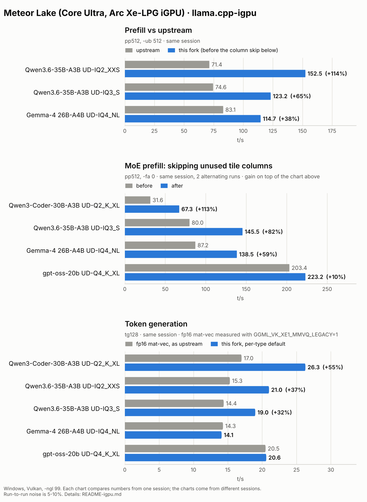
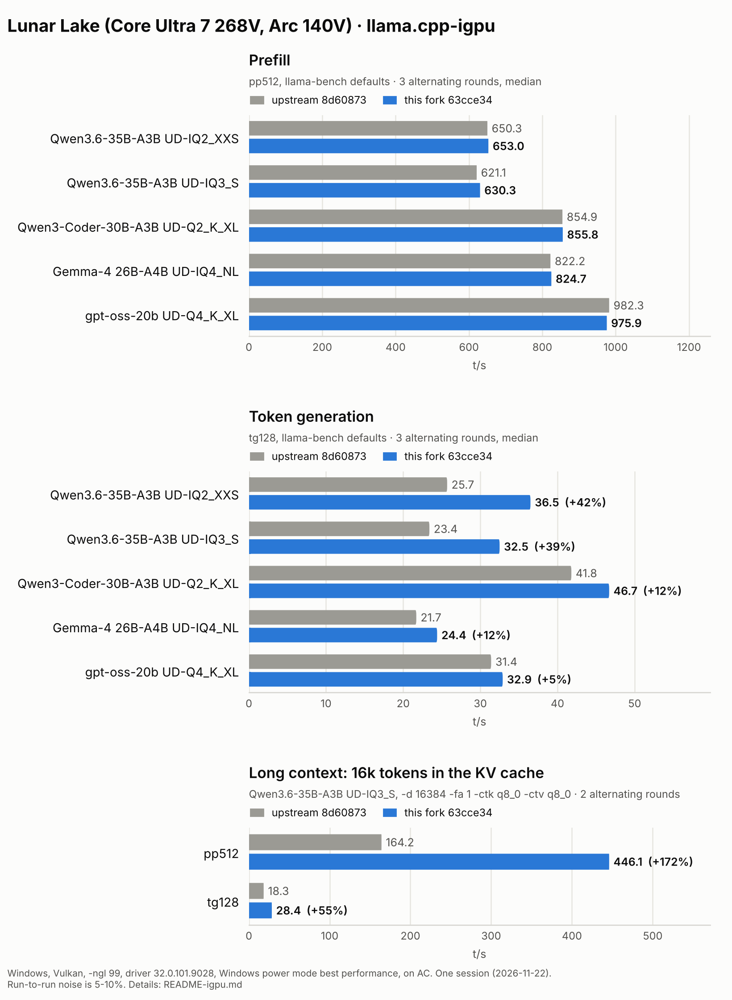

# llama.cpp for integrated GPUs (Vulkan)

A fork of [ggml-org/llama.cpp](https://github.com/ggml-org/llama.cpp) tuned for **integrated GPUs**:
Intel Meteor Lake (Arc Xe-LPG, no matrix cores) for prefill and Lunar Lake (Arc 140V, Xe2) for token generation,
with a focus on **low-bit quants (Q2-Q4, IQ\*)** that people actually run on laptops: MoE models at 2-4 bits per weight.

Everything here is in the Vulkan backend. Other backends are untouched.

## What is different from upstream

| Area | Change | Status |
|---|---|---|
| Prefill, IQ2_S | integer dot (q8_1) MMQ shaders for mul_mat and mul_mat_id | measured |
| Prefill, IQ4_NL | integer dot MMQ shaders (upstream only had them on coopmat GPUs) | measured |
| Prefill, IQ2_XXS / IQ2_XS / IQ3_XXS | integer dot MMQ shaders | measured (Qwen3.6 UD-IQ2_XXS) |
| Prefill, MoE (`mul_mat_id` integer dot MMQ) | a tile covers up to BN rows of one expert; columns past the rows the expert has are no longer loaded or multiplied. With 128-256 experts most of a 64-column tile is empty at pp512 | measured on Meteor Lake |
| Prefill with a quantized KV cache (e.g. `-ctk q8_0 -ctv q8_0`), Xe2 | upstream converts the cache to f16 before flash attention, but then still checked the original type for the Intel flash attention kernels (`xe_fa`) and fell back to the generic scalar shader, 10x slower. The converted cache now uses the Intel kernels. `GGML_VK_XE_FA_NO_DEQUANT=1` restores the old behavior | measured on Lunar Lake |
| Token generation with a q8_0 KV cache, Xe2 | the Intel flash attention decode kernels read q8_0 K/V directly (dequantized on load) instead of falling back to the generic shader. `GGML_VK_XE_FA_NO_Q8_DECODE=1` restores the old behavior | measured on Lunar Lake |
| Prefill with flash attention, Xe-LPG iGPU | the generic flash attention shader uses other tiles per head size and shader: head size 256, integer dot version (quantized K, e.g. `-ctk q8_0`): 16 query rows and 256 threads instead of 8 and 128; head size 256, f16: 4 rows and d split 4; head size 512 (Gemma-4 global layers): 256 threads, and 4 rows for f16. `GGML_VK_XE1_FA_DEFAULT_TILE=1` restores the old shapes | measured on Meteor Lake |
| Token generation with flash attention, Xe-LPG iGPU | the generic flash attention shader uses 256 threads per workgroup instead of 128 when it runs one token (also with GQA rows); head size 512 uses 512 threads and half the KV splits, and with 8 GQA rows row split 8 instead of 4 (row split 4 spilled registers). `GGML_VK_XE1_FA_DECODE_WG128=1` restores 128, `GGML_VK_XE1_FA_DECODE_RS4=1` row split 4 | measured on Meteor Lake |
| Token generation with flash attention and a quantized K cache, Xe-LPG iGPU | head size 64 (gpt-oss: 8 query heads per KV head, tile of 4 rows) ran without GQA; a workgroup now takes 4 query heads of one KV head (GQA fold). f16 keeps GQA off (slower). `GGML_VK_XE1_FA_NO_GQA_FOLD=1` turns it off | measured on Meteor Lake |
| Prefill, IQ1_S / IQ1_M | integer dot MMQ shaders (`8 * (grid + delta)` is an exact int8); UD-IQ2_XXS quants also contain many IQ1_S tensors | tests pass on Meteor Lake |
| Qwen3.5/3.6 (Gated DeltaNet) | `gated_delta_net` variant that shares each token's k/q between 16 subgroups via shared memory (Intel only) | measured |
| Qwen3.5/3.6 prefill, Xe2 | that variant loads k/q/g/beta of 8 tokens per shared memory block, so the workgroup waits once per 8 tokens instead of every token; calls with more than 1024 tokens keep 1 token per block (slower with 8). `GGML_VK_GDN_TB=N` sets the block size | measured on Lunar Lake |
| Token generation, IQ2_S / IQ3_S / IQ4_NL | integer dot mat-vec (MMVQ) shaders, incl. MoE (`mul_mat_vec_id`) | measured on Lunar Lake |
| Token generation, IQ2_XXS / IQ2_XS / IQ3_XXS | integer dot mat-vec (MMVQ) shaders, incl. MoE; grid from the storage buffer like IQ2_S / IQ3_S | measured on Lunar Lake |
| Token generation, Xe2 + Windows driver | MMVQ for every type that has it (upstream: Q2_K/Q3_K/Q6_K only), tuned rows per workgroup (Q6_K: 4) | measured on Lunar Lake |
| Token generation, IQ2_S / IQ3_S | MMVQ reads the grid tables from a small storage buffer instead of copying them into shared memory in every workgroup (token generation launches many small workgroups); `GGML_VK_MMVQ_IQ_SHMEM=1` selects the shared memory copy, kept bit-packed (IQ2_S 8 KiB -> 2 KiB, IQ3_S 2 KiB -> 1 KiB) | measured on Lunar Lake |
| Token generation, Qwen3.5/3.6 and other delta-net models | when a ubatch reads its single recurrent state from the cell it writes back to (one sequence), use a view of that cell instead of gathering a copy with `GET_ROWS` (graph change, all backends) | measured on Lunar Lake |
| Token generation, Xe-LPG iGPU + Windows driver | MMVQ per type: Q2_K, Q3_K, Q4_K, Q5_K, IQ2_XXS, IQ2_S, IQ4_XS, IQ3_S for k < 2048, MXFP4 MoE, dense Q8_0 and dense Q6_K (4 rows) with the large workgroup; fp16 for the rest (upstream: fp16 for every type) | measured on Meteor Lake |
| Token generation, MMVQ | optional lane split: several rows per subgroup, a few lanes per row (`GGML_VK_MMVQ_LANES`); on by default only for IQ3_S MoE on Xe2 (8 lanes per row) | measured on Lunar Lake |

Upstream already has integer dot MMQ for Q2_K..Q6_K, Q4_0/Q4_1/Q5_x/Q8_0, IQ3_S, IQ4_XS and MXFP4.

## Measured results





The charts are drawn from the tables below by `docs/igpu/make_charts.py`; each chart compares numbers from one session.

Measuring on the Meteor Lake laptop: run-to-run noise is 5-10%, and the machine state can move the absolute numbers by
25-30%. Seen so far: the package power stuck near 40 W on AC until something switched the limit up, and thermal
throttling (HWiNFO) with the room heated, gone with the heating off (about 20 C lower). Compare settings in
alternating rounds within one session; treat absolute numbers from different sessions with care.

### Meteor Lake: upstream vs this fork

`bench-compare.ps1`, 2026-11-22 (second run): Core Ultra 5 135H, driver 32.0.101.9028, Dell Optimizer "Ultra Performance",
on AC. Upstream 8d60873 vs this fork 9db50c9, `llama-bench` defaults, 3 alternating rounds (2 at depth 16384), median t/s:

| model | pp512 upstream | pp512 fork | tg128 upstream | tg128 fork |
|---|---|---|---|---|
| Qwen3.6-35B-A3B UD-IQ2_XXS | 68.2 | 229.3 (3.36x) | 15.0 | 23.7 (1.58x) |
| Qwen3.6-35B-A3B UD-IQ3_S | 77.8 | 209.6 (2.69x) | 14.9 | 19.3 (1.30x) |
| Qwen3-Coder-30B-A3B UD-Q2_K_XL | 33.9 | 71.6 (2.11x) | 18.7 | 31.4 (1.68x) |
| Gemma-4 26B-A4B UD-IQ4_NL | 86.9 | 187.9 (2.16x) | 14.5 | 16.0 (1.10x) |
| gpt-oss-20b UD-Q4_K_XL | 303.7 | 331.9 (1.09x) | 20.6 | 21.7 (1.05x) |
| Qwen3.6 IQ3_S, depth 16384, `-fa 1 -ctk q8_0 -ctv q8_0` | 48.3 | 109.5 (2.27x) | 11.8 | 16.8 (1.42x) |

Medians, because single rounds dropped (gpt-oss fork tg128 16.6 in the first round, 21.7 and 22.0 after it).
Compared with the first run of the day (fork 02d5e70 the day before: Gemma-4 tg 0.99x, gpt-oss 1.01x), Gemma-4 tg is
now 1.10x (dense Q8_0 MMVQ) and gpt-oss 1.05x (MXFP4 MoE MMVQ).

The fork's prefill numbers are higher than in the older tables below (Qwen3.6 UD-IQ3_S pp512 about 210 now, 123-145
then; at depth 16384 with a q8_0 cache 69 then, 110 now). It is not the rebase (the release before it, 4ea9498, also
gives pp512 205-215 now). In between the driver changed (32.0.101.8991 -> 9028) and the laptop's power setting may
have differed (Dell Optimizer "Ultra Performance" now; the Windows power mode that the script reads does not show
it). Which of the two it is was not separated. Upstream changed much less (pp512 74.6 then, 78 now). The older tables were not
re-measured.

### Lunar Lake: upstream vs this fork

`bench-compare.ps1`, 2026-11-24: Core Ultra 7 268V (Arc 140V), driver 32.0.101.9028, Windows power mode best
performance, on AC. Upstream 212c547 vs this fork 1f9f04f (rebased onto 212c547), `llama-bench` defaults,
3 alternating rounds (2 at depth 16384), median t/s:

| model | pp512 upstream | pp512 fork | tg128 upstream | tg128 fork |
|---|---|---|---|---|
| Qwen3.6-35B-A3B UD-IQ2_XXS | 642.6 | 643.9 (1.00x) | 25.5 | 36.6 (1.43x) |
| Qwen3.6-35B-A3B UD-IQ3_S | 630.2 | 639.3 (1.01x) | 23.9 | 32.7 (1.37x) |
| Qwen3-Coder-30B-A3B UD-Q2_K_XL | 860.7 | 863.3 (1.00x) | 41.4 | 45.9 (1.11x) |
| Gemma-4 26B-A4B UD-IQ4_NL | 820.0 | 817.3 (1.00x) | 21.1 | 24.1 (1.14x) |
| gpt-oss-20b UD-Q4_K_XL | 985.0 | 987.5 (1.00x) | 31.4 | 33.1 (1.05x) |
| Qwen3.6 IQ3_S, depth 16384, `-fa 1 -ctk q8_0 -ctv q8_0` | 151.3 | 427.4 (2.82x) | 18.4 | 26.8 (1.46x) |

The fork numbers match the previous run (2026-11-22, fork 63cce34 on upstream 8d60873) within noise; the rebase
changed nothing on Lunar Lake. The depth 16384 rounds varied the most (fork tg 25.6 / 28.1, pp 394 / 461).

On Lunar Lake prefill at short context runs on the same FP16 XMX matmuls as upstream; the fork's gains are token
generation and long context with a quantized KV cache. Note: the older Lunar Lake tables below that name
"UD-IQ3_S" were measured with a file that was actually UD-IQ3_XXS.

### Prefill, Meteor Lake

Intel Core Ultra (Meteor Lake), Arc iGPU, DDR5-5600 x2, Windows, `-ngl 99`.

| Model | Test | Upstream | This fork |
|---|---|---|---|
| Qwen3.6-35B-A3B UD-IQ3_S | pp4096, `-ub 4096` | 79.0 t/s | 144.8 t/s |
| Gemma-4 26B-A4B UD-IQ4_NL | pp512, `-ub 512` | 69.0 t/s | 90.9 t/s |
| Gemma-4 26B-A4B UD-IQ4_NL | pp2048, `-ub 2048` | 80.4 t/s | 101.4 t/s |

Core Ultra 5 135H, driver 32.0.101.8991, upstream 9fba51d vs this fork b9f1952, `-fa 0 -r 2`, 2 alternating runs (mean):

| Model | pp512 (`-ub 512`) upstream / fork | pp2048 (`-ub 2048`) upstream / fork |
|---|---|---|
| Qwen3.6-35B-A3B UD-IQ2_XXS | 71.4 / 152.5 (+114%) | 95.0 / 197.3 (+108%) |
| Qwen3.6-35B-A3B UD-IQ3_S | 74.6 / 123.2 (+65%) | 102.5 / 183.9 (+79%) |
| Gemma-4 26B-A4B UD-IQ4_NL | 83.1 / 114.7 (+38%) | 101.6 / 128.3 (+26%) |
| gpt-oss-20b UD-Q4_K_XL (MXFP4 experts) | 298.9 / 298.2 | 234.8 / 237.9 |
| Qwen3-Coder-30B-A3B UD-Q2_K_XL (K-quant experts) | 35.1 / 35.1 | 49.8 / 49.4 |

All `test-backend-ops` checks pass on this GPU (new IQ MMQ types, `GATED_DELTA_NET`, MMVQ forced on).

MoE prefill, skipping the unused columns of a tile. The slow MoE prefill came from mostly empty MoE tiles, not from
the quant decode: dense Q4_K mat-mul ran at 2000-2600 GFLOPS, the MoE ones at 100-290; SIMD8 and other MoE tiles did
not help. The float / coopmat shader (`mul_mm.comp`) already skipped these columns upstream, the integer dot one
(`mul_mmq.comp`) did not. Later session; the machine was slower than above, so compare within the table only.
`-fa 0 -r 1`, 2 alternating runs (mean):

| Model | pp512 before / after | pp2048 before / after |
|---|---|---|
| Qwen3-Coder-30B-A3B UD-Q2_K_XL (128 experts) | 31.6 / 67.3 (+113%) | 44.3 / 55.0 (+24%) |
| Qwen3.6-35B-A3B UD-IQ3_S (256 experts) | 80.0 / 145.5 (+82%) | 122.7 / 153.2 (+25%) |
| Gemma-4 26B-A4B UD-IQ4_NL (128 experts) | 87.2 / 138.5 (+59%) | 92.0 / 110.5 (+20%) |
| gpt-oss-20b UD-Q4_K_XL (32 experts) | 203.4 / 223.2 (+10%) | 170.9 / 184.0 (+8%) |

The Gemma-4 and gpt-oss rows are not alternating: "before" is from the day before (4 runs), "after" is 3 runs of
`-r 2` with 65e05a0, and the Windows power mode may have differed. Differences of 10% are within that noise; the
Gemma-4 gain is not. As expected, few experts (full tiles) gain little.

Skipping only the dot products gave about half of this (59.6 and 121.8 t/s at pp512). Forcing the smaller tile
(32 columns instead of 64) instead was faster for Q2_K (pp512 52.5) but slower for every other model tested
(Qwen3.6 IQ3_S / IQ2_XXS -20 to -34%, gpt-oss-20b -11%), and slower than column skipping with the 64-column tile.

### Prefill, Lunar Lake

Qwen3.6-35B-A3B UD-IQ3_S, Gated DeltaNet tokens per block (`GGML_VK_GDN_TB`), t/s, 2 alternating runs of `-r 1`,
flash attention on (default). llama.cpp splits prompts into ubatches of 512 tokens by default (`-ub`).

| Tokens per block | pp512 | pp2048 `-ub 512` | pp2048 `-ub 1024` | pp2048 `-ub 2048` |
|---|---|---|---|---|
| 1 (before) | 587.8 | 597.2 | 692.9 | 670.6 |
| 4 | 625.6 | 618.3 | 690.7 | 580.1 |
| 8 (new default up to 1024 tokens per call) | 639.9 (+9%) | 630.8 (+6%) | 710.6 | 565.3 |

GATED_DELTA_NET per call at 512 tokens: 4.67 ms (1 token per block) -> 3.74 ms (8). With 2048 tokens per call it
gets slower (28.0 -> 45.8 ms), so calls above 1024 tokens keep 1 token per block. tg128 does not change (32.1 / 32.1).
`-ub 1024` is the fastest ubatch size here for long prompts (about +13% over the default 512).

On Meteor Lake the same blocks do not help (t/s, same test, `GGML_VK_GDN_TB`; pp512 at TB 1 had one slow run):

| Tokens per block | pp512 | pp2048 `-ub 512` | pp2048 `-ub 1024` | pp2048 `-ub 2048` |
|---|---|---|---|---|
| 1 (default there) | 137.5 | 142.3 | 154.7 | 159.6 |
| 2 | 153.0 | 139.1 | 151.0 | 147.6 |
| 4 | 149.2 | 142.1 | 150.3 | 152.0 |
| 8 | 132.9 | 138.2 | 140.3 | 146.9 |

The MoE prefill tile (`mul_mm.comp`, coopmat) was checked too: the default (large, 128 columns) is the fastest for
Qwen3.6 IQ3_S, Gemma-4 IQ4_NL and gpt-oss-20b; forcing 32 or 64 columns is 20-70% slower.

Prefill with a q8_0 KV cache (`-ctk q8_0 -ctv q8_0`), Qwen3.6-35B-A3B UD-IQ3_S, pp512 at 16k context (`-d 16384 -ub 1024`):
f16 cache 472, q8_0 before 167, q8_0 now 445 t/s. One flash attention call (head size 256, 2 KV heads x 8, KV 16384,
512 queries, `test-backend-ops perf`): f16 24.0 ms, q8_0 before 237-298 ms, now 25.5 ms (the f16 conversion).

Other models, pp512 at 16k context with the fix (`-ub 1024 -r 1`, single runs, so about 10% noise):

| Model | f16 cache | q8_0 cache |
|---|---|---|
| Gemma-4 26B-A4B UD-IQ4_NL | 411.2 | 453.2 |
| gpt-oss-20b UD-Q4_K_XL | 662.9 | 621.1 |
| Qwen3-Coder-30B-A3B UD-Q2_K_XL | 294.4 | 332.1 |
| Qwen3-Coder-30B-A3B UD-Q3_K_XL | 326.7 | 295.6 |

Before the fix q8_0 prefill at 8k context was 2-3x slower than f16 for Gemma-4 and gpt-oss (172 vs 561, 310 vs 793).

Token generation with a q8_0 KV cache, Qwen3.6-35B-A3B UD-IQ3_S, tg1024 at 16k context (`-d 16384`): generic shader
23.2 t/s, Intel decode kernels reading q8_0 27.2 t/s (f16 cache: about 29).

### Token generation, Lunar Lake

Intel Core Ultra (Lunar Lake), Arc 140V, LPDDR5X, Windows, `llama-bench -p 0 -n 128 -r 3`.

| Model | Test | Upstream | This fork |
|---|---|---|---|
| Qwen3.6-35B-A3B UD-IQ3_S | tg128 | 23.8 t/s (23.4-24.0) | 28.5 t/s (28.0-28.7) |
| Qwen3.6-35B-A3B UD-IQ3_S | pp512 | 573.9-592.8 t/s | 613.3-618.4 t/s |

tg128: upstream 5a4afd8 vs this fork eaf44b1, 5 alternating runs each, mean and range: +20%.
pp512 was measured with an earlier build of this fork (before the MMVQ grid packing and Q6_K changes).

Run-to-run variation on this laptop is about 5-10% (power and thermal state) and differs between sessions, so each step below was compared
against the step before it in the same session, and the per-op timings (`GGML_VK_PERF_LOGGER=1`) were checked to
move where expected.

| Step | Model | Before | After | Where it comes from |
|---|---|---|---|---|
| packed IQ grid tables | Qwen3.6-35B-A3B UD-IQ3_S | 23.0 t/s | 23.9 t/s | IQ2_S MoE gate/up 93.5 -> 74.9 us per call |
| packed IQ grid tables (+ rows per workgroup) | Qwen3.6-35B-A3B UD-IQ2_XXS | 26.1 t/s | 28.4 t/s | IQ2_S MoE down 126 -> 69 us per call |
| Q6_K: 4 rows per workgroup | Qwen3.6-35B-A3B UD-IQ3_S | 23.9 t/s | 24.8 t/s | dense Q6_K is about half of the token time in this quant |
| IQ3_S MoE: 8 lanes per row | Gemma-4 26B-A4B UD-IQ4_NL | 20.2 t/s | 21.0 t/s | IQ3_S gate_up (k=2816) 300 -> 245 us per call |
| IQ4_NL MoE: 8 lanes per row, 4 rows (was 1 subgroup per row, 2 rows) | Gemma-4 26B-A4B UD-IQ4_NL | 23.39 t/s (23.34-23.44) | 24.46 t/s (24.37-24.52) | IQ4_NL down (m=2816, k=704 = 22 blocks) 198 -> 131 us per call, gate_up (k=2816) 345 -> 295 us; 3 alternating rounds with `GGML_VK_MMVQ_ID_LANES` / `GGML_VK_MMVQ_ID_ROWS`, build 963be5f. A first run on a warm machine: 156 us, 19.8 -> 21.3 t/s |
| recurrent state read in place | Qwen3.6-35B-A3B UD-IQ3_S | 28.85 t/s | 30.24 t/s | 60 of 62 `GET_ROWS` per token gone (1.8 ms); `GATED_DELTA_NET` +0.3 ms since the state no longer comes from cache; 5 alternating runs each |
| IQ grid tables in a storage buffer (vs bit-packed shared memory) | Qwen3.6-35B-A3B UD-IQ3_S | 30.24 t/s | 31.39 t/s | 6 alternating runs each |
| IQ grid tables in a storage buffer | Qwen3.6-35B-A3B UD-IQ2_XXS | 32.97 t/s | 33.80 t/s | |
| IQ grid tables in a storage buffer | Gemma-4 26B-A4B UD-IQ4_NL | 22.07 t/s | 22.79 t/s | |
| MMVQ for IQ2_XXS / IQ2_XS / IQ3_XXS | Qwen3.6-35B-A3B UD-IQ2_XXS | 33.95 t/s (33.7-34.1) | 35.67 t/s (35.2-36.1) | 3 alternating runs each, faster in every round |
| MMVQ for IQ2_XXS / IQ2_XS / IQ3_XXS | Qwen3.6-35B-A3B UD-IQ3_XXS | 31.24 t/s (31.2-31.3) | 31.61 t/s (31.5-31.8) | same; small gain, within the run-to-run spread of other sessions |
| IQ2_S / IQ2_XXS MoE: 4 rows per workgroup (was 16) | Qwen3.6-35B-A3B UD-IQ3_XXS | 31.62 t/s (31.5-31.7) | 32.71 t/s (32.6-32.9) | IQ2_S gate/up 60 -> 50 us per call; 3 alternating runs each, set with `GGML_VK_MMVQ_ID_ROWS` |
| IQ2_S / IQ2_XXS MoE: 4 rows per workgroup (was 16) | Qwen3.6-35B-A3B UD-IQ3_S | 32.03 t/s (32.0-32.1) | 32.86 t/s (32.8-32.9) | same; measured with all IQ2/IQ3 types at 4 rows |
| IQ2_S / IQ2_XXS MoE: 4 rows per workgroup (was 16) | Qwen3.6-35B-A3B UD-IQ2_XXS | 36.21 t/s (35.9-36.6) | 37.05 t/s (36.9-37.2) | IQ2_XXS gate/up 50 -> 40 us per call; measured with all IQ2/IQ3 types at 4 rows |

The absolute numbers in this table are lower than the alternating runs above because they were taken in
other sessions; compare within a row only.

Other models on the current build, for reference: GLM-4.7-Flash UD-Q3_K_XL 25.3-25.7 t/s,
LFM2 MoE 24B-A2B Q4_K_S 48.3 t/s.

### Token generation, Meteor Lake

Same machine and builds, tg128, 2 alternating rounds of `-r 3`. The new per-type MMVQ default is not in this build;
"MMVQ forced" (`GGML_VK_FORCE_MMVQ=1`) shows the effect for the models whose MoE experts are all MMVQ-friendly types.

| Model | upstream | fork (fp16 mat-vec) | fork, MMVQ forced |
|---|---|---|---|
| Qwen3-Coder-30B-A3B UD-Q2_K_XL | 18.9 | 18.8 | 30.1 (+60%) |
| Qwen3.6-35B-A3B UD-IQ2_XXS | 15.8 | 16.2 | 23.1 (+46%) |
| Qwen3.6-35B-A3B UD-IQ3_S | 15.7 | 15.7 | 20.4 (+30%) |
| Gemma-4 26B-A4B UD-IQ4_NL | 14.7 | 14.6 | 13.1 (-10%) |
| gpt-oss-20b UD-Q4_K_XL | 20.6 | 20.6 | 16.6 (-19%) |

Per-op timings show which types win: Q8_0, MXFP4 and IQ4_NL mat-vecs are slower with MMVQ on this GPU, so the
per-type default above keeps them on fp16. GPU time per token is at or above wall time, so submission is not the limit.

The per-type default, measured later on the same machine (build 67e7220, other session, so compare within the table only):
it matches the faster of the two other settings for every model.

| Model | fork default (per type) | `GGML_VK_XE1_MMVQ_LEGACY=1` (fp16) | `GGML_VK_FORCE_MMVQ=1` |
|---|---|---|---|
| Qwen3-Coder-30B-A3B UD-Q2_K_XL | 26.3 (25.2-27.4) | 17.0 | 26.9 (26.6-27.3) |
| Qwen3.6-35B-A3B UD-IQ2_XXS | 21.0 (20.4-21.6) | 15.3 | 21.3 (21.0-21.7) |
| Qwen3.6-35B-A3B UD-IQ3_S | 19.0 (18.8-19.3) | 14.4 | 19.2 (18.6-19.7) |
| Gemma-4 26B-A4B UD-IQ4_NL | 14.1 | 14.3 | 12.7 |
| gpt-oss-20b UD-Q4_K_XL | 20.6 | 20.5 | 16.1 |

MXFP4 MoE (gpt-oss) was slower with MMVQ in the single-subgroup shape used above, but faster with the large
workgroup, which is now the default for MXFP4 `mul_mat_vec_id` on this GPU. gpt-oss-20b UD-Q4_K_XL, tg128,
5 alternating rounds after 3 warm-up runs, build e2ab895 with a test patch, driver 32.0.101.9028:

| MXFP4 MoE mat-vec | tg128 t/s mean (min-max) | us per call (perf logger) |
|---|---|---|
| fp16 path (old default) | 20.82 (19.36-21.40) | 415 |
| MMVQ, large workgroup, 4 rows (new default) | 22.27 (21.74-22.46) / 22.36 (22.16-22.48) | 374-385 |
| MMVQ, large workgroup, 1 row | 20.42 (20.15-20.64) | 431 |
| MMVQ, large workgroup, subgroup 16 | 17.85 (17.69-17.97) | 512 |
| MMVQ, large workgroup, subgroup 32 | 18.93 (18.37-19.14) | 482 |

Check on the committed build (80c94d5, no patch, 3 alternating rounds of `-r 3`): 22.15 t/s (21.81-22.46) vs 20.88
(20.69-21.16) with `GGML_VK_XE1_MMVQ_LEGACY=1` (which also puts the dense Q4_K mat-vecs back on fp16), faster in every round.

The 4-row line was measured twice (the default and an explicit `GGML_VK_MMVQ_ID_ROWS=mxfp4=4`), which shows the
noise of this run.

Dense Q8_0 (Gemma-4 attention, shared FFN and output layer, 60% of its token time) is also faster with MMVQ and the
large workgroup: every projection shape 15-20% faster per call (2112x2816 118 -> 98 us, 4096x2816 220 -> 179 us),
the output layer 3%. tg128, 7 alternating rounds after 3 warm-up runs (build 80c94d5 with a test patch):

| Q8_0 dense mat-vec | Gemma-4 26B-A4B UD-IQ4_NL | gpt-oss-20b UD-Q4_K_XL |
|---|---|---|
| fp16 path (old default) | 14.44 (13.14-15.18), last 5 rounds 14.92 | 22.06 (21.71-22.22) |
| MMVQ, large workgroup, 2 rows (new default) | 15.83 (14.80-16.23), last 5 rounds 16.02 | 22.12 (21.67-22.48) |
| MMVQ, large workgroup, 1 row | 14.43 (12.96-15.04) | 21.50 (21.30-21.80) |
| MMVQ, large workgroup, 4 rows | 15.93 (14.97-16.29) | 22.15 (21.55-22.45) |

The first two fp16 rounds of Gemma-4 were slow (13.1, 13.3), so the last 5 rounds are given as well (+7%). gpt-oss
gains nothing: its Q8_0 is mostly the output layer. Q8_0 MoE stays on fp16.

Check on the committed build (9db50c9, no patch; `test-backend-ops` MUL_MAT 2604/2604, MUL_MAT_ID 1197/1197),
5 alternating rounds: Gemma-4 15.71 (15.26-15.94) vs 14.81 (14.38-15.02) with `GGML_VK_XE1_MMVQ_LEGACY=1` (1.06x,
faster in every round; for this model LEGACY changes only the Q8_0 mat-vecs).

Dense Q6_K (Qwen3.6 UD-IQ3_S: 56% of the token time; UD-IQ2_XXS 13%, Qwen3-Coder 15%) also takes MMVQ with the
large workgroup now, with 4 rows. Dense Q4_K / Q5_K keep MMVQ with one subgroup: the large workgroup made them
slower (Qwen3.6 UD-IQ2_XXS Q5_K 13.7 -> 16.0 ms per token, tg128 -4%). `mtl-kquant.ps1`, build cde13ae with a test
patch, tg128 of 5 alternating rounds, mean (median):

| dense Q6_K mat-vec | Qwen3.6 UD-IQ3_S | Qwen3.6 UD-IQ2_XXS | Qwen3-Coder UD-Q2_K_XL |
|---|---|---|---|
| fp16 path (old default) | 19.85 (19.97) | 23.03 (23.77) | 31.60 (31.64) |
| MMVQ, one subgroup | 20.46 (20.48) | 24.34 (24.79) | 32.20 (32.23) |
| MMVQ, large workgroup, default rows | 19.55 (19.64) | 24.87 (24.89) | 31.84 (31.81) |
| MMVQ, large workgroup, 4 rows (new default) | 20.78 (20.94) | 24.83 (24.76) | 32.42 (32.52) |

The 4-row setting was best or tied on all three (+5%, +4%, +3% by median; the fp16 rounds of the IQ2_XXS model
include one at 19.2). Here the perf logger again disagreed with tg: it showed Q6_K slower with MMVQ on UD-IQ3_S
(29.1 -> 31.4 ms per token) while tg went up.

Gemma-4 IQ3_S gate_up (k=2816) and IQ4_NL down (k=704) were tried with the default shape, the large workgroup, lane
splits and subgroup 8/16/32; none beat fp16 in tg128 (Gemma-4 fp16 15.09, MMVQ 14.70-14.95), so they stay on fp16. Per-op times from the perf logger did not predict tg here (it runs one
op at a time): some shapes were faster per call and 20% slower in tg.

### Token generation with flash attention on Meteor Lake

At long context the decode attention read the KV cache at about 11 GB/s (Qwen3.6, depth 16384: 16.6 of 66 ms per
token), while the weight mat-vecs read 30-70 GB/s. 256 threads per workgroup instead of 128 (build 9e1b619 with a test
patch, 3 alternating rounds for `test-backend-ops perf`, 2 for llama-bench):

| | 128 threads | 256 threads |
|---|---|---|
| FA, 2 KV heads x 8, 1 token, KV 16384, q8_0 | 1307 us | 835 us |
| FA, same, f16 | 1466 us | 763 us |
| Qwen3.6-35B-A3B UD-IQ3_S tg64 at d16384, `-fa 1` q8_0/q8_0 | 15.17 | 16.60 |
| Qwen3-Coder-30B-A3B UD-Q2_K_XL tg64 at d4096, `-fa 1` | 14.80 | 20.04 |
| Gemma-4 26B-A4B UD-IQ4_NL tg64 at d4096, `-fa 1` | 12.18 | 12.55 |
| gpt-oss-20b UD-Q4_K_XL tg64 at d4096, `-fa 1` | 17.69 | 18.11 |

More KV splits, 64 columns per block, 512 threads, row split 1 or 8 and d split 4 or 16 were slower or no better.

### Flash attention per head size on Meteor Lake

At depth 16384 the flash attention of Gemma-4 (head size 512 in its 5 global layers) and gpt-oss (head size 64) was
far behind Lunar Lake: per call 5.3 ms (Lunar 1.25) and 2.2 ms (0.53) for one token, 856 ms (41) and 107 ms (9.2) for
512 prompt rows at KV 8192 (`att-prof.ps1`). FLASH_ATTN_EXT alone, model shapes (2 KV heads x 8 for head size 256 and
512, 8 KV heads x 8 with sinks for 64), `test-backend-ops perf` with a test patch that overrides the tile
(`mtl-fa-sweep.ps1`, `mtl-fa-sweep2.ps1`, build 8fdcbb9), fastest of 2 rounds, us per call:

| shape | old f16 | new f16 | old q8_0 | new q8_0 | new setting |
|---|---|---|---|---|---|
| hs 512, 1 token, KV 16384 | 7,176 | 4,745 | 5,473 | 3,903 | 512 threads, split_k 16 -> 8 |
| hs 512, 512 rows, KV 8192 | 517,389 | 334,506 | 1,134,159 | 508,798 | 256 threads; f16 also 4 rows |
| hs 256, 512 rows, KV 8192 | 194,761 | 121,420 | 124,831 | 124,831 | f16: 4 rows, d split 4 (q8_0 unchanged) |

The prefill shapes apply above 32 rows only: the GQA limit for one token is taken from the 32-row tile, and fewer
than 8 rows there would turn GQA off for the 8 query heads per KV head. Not changed:
- hs 256, one token: the current default (256 threads, split_k 16) was best or tied.
- hs 64 (gpt-oss), one token (now changed for a quantized K, see the next section): it runs without GQA on Meteor Lake (the 32-row tile has 4 rows, so 8 query heads do
  not fit). With GQA a workgroup covers only its first block of rows (`i = 0` in `init_indices`), so the GQA ratio
  must not exceed block_rows: with 4 rows the shader computed only 4 of the 8 heads (2 tests fail, and the time,
  f16 573 us, is not comparable). With 8 rows it was slower (f16 707 -> 929 us, q8_0 1376 -> 1345). split_k,
  columns and threads did not help either.
- hs 64, prefill: the default was fastest.
The q8_0 shader is a different shader (integer dot) and reacts differently: d split 4 made the hs 256 prefill 6x
slower there, 4 rows 2-7x slower.

Real models on the committed build (a6e6b61, no patch; `test-backend-ops` FLASH_ATTN_EXT 5693/5693), depth 8192,
`mtl-fa-check.ps1`, mean of 2 alternating rounds, t/s. "old tile" is `GGML_VK_XE1_FA_DEFAULT_TILE=1` (all prefill
tiles back, including the older q8_0 head size 256 one; the head size 512 token generation change stays):

| model | KV | pp512 old tile | pp512 new | tg32 old tile | tg32 new |
|---|---|---|---|---|---|
| Gemma-4 26B-A4B UD-IQ4_NL | `-fa 1` f16 | 84.3 | 104.9 (+24%) | 11.79 | 11.99 |
| Gemma-4 26B-A4B UD-IQ4_NL | `-fa 1` q8_0 | 64.5 | 89.7 (+39%) | 12.76 | 12.60 |
| Qwen3.6-35B-A3B UD-IQ3_S | `-fa 1` f16 | 113.4 | 135.6 (+20%) | 18.37 | 17.83 |
| Qwen3.6-35B-A3B UD-IQ3_S | `-fa 1` q8_0 | 114.8 | 136.2 (+19%) | 18.25 | 18.49 |

`-fa 0` f16 at the same depth: Gemma-4 147.8 / 13.64, Qwen3.6 162.9 / 18.64. At depth 8192 the prefill without flash
attention is still faster on this GPU, and Gemma-4 token generation too.

### Flash attention token generation: row split and GQA fold (Meteor Lake)

`GGML_VK_PIPELINE_STATS` works with the Windows driver (VK_KHR_pipeline_executable_properties); it reports no SIMD
width or registers, but "Scratch Memory Size" shows register spills. Spilling shaders at the Gemma-4 / Qwen3.6 shapes:
head size 512 with 8 GQA rows for one token, 5.3 KB (f16) / 5.8 KB (q8_0) with row split 4; the q8_0 (integer dot)
prefill tiles, 4.4 KB (head size 256, 16 rows) and 3.4 KB (512, 8 rows). Lunar Lake runs the Intel kernels (`xe_fa`)
there, none of them spills.

Build 1f9f04f with a test patch (`igpu-probe-1126.ps1`, `igpu-probe-1127.ps1`), depth 16384, median of 3 (2 for the
last two tables) alternating rounds, t/s:

| tg32 at d16384 | old | new | |
|---|---|---|---|
| Gemma-4 26B-A4B UD-IQ4_NL, `-fa 1` f16, head size 512 row split 4 -> 8 | 11.11 | 13.14 | +18% |
| same, q8_0 | 11.88 | 11.82 | no spill now, same speed |
| gpt-oss-20b UD-Q4_K_XL, `-fa 1` q8_0, GQA fold of 4 | 13.05 | 13.92 | +7% |
| same, f16 (not used) | 12.53 | 11.73 | -6% |

Tried, not changed:
- Fewer rows for the q8_0 prefill tiles (no spills then): pp512 at d16384 Qwen3.6 99.6 -> 73.2 (8 rows) / 51.4 (4 rows),
  Gemma-4 61.2 -> 40.4 / 37.7. The spills cost less than the smaller tiles.
- The Xe core count (unknown to the backend on both iGPUs, which changes split_k guesses): 7 on Meteor Lake was 0-3%
  slower at depth 0 and 5% slower for tg at d16384; 8 on Lunar Lake within 1% everywhere.

Gemma-4 at d16384 with the new row split, pp512 / tg32: `-fa 0` f16 113.0 / 12.09, `-fa 1` f16 77.0 / 12.58,
`-fa 1` q8_0 65.5 / 11.72. Token generation is now on par with `-fa 0`, prefill is not, so `-fa 0` stays the advice.

### Long context prefill on Meteor Lake (flash attention)

Qwen3.6-35B-A3B UD-IQ3_S, pp512 at depth (`-d`), default `-ub 512`, 2 alternating runs (mean), build c271846 with a
test patch for the tile shape. Meteor Lake has no Intel flash attention kernels, so the generic scalar shader runs:

| Setting | d4096 | d16384 |
|---|---|---|
| `-fa 1`, q8_0/q8_0, old tile (8 rows, 128 threads) | 107.3 | 54.2 |
| `-fa 1`, q8_0/q8_0, new tile (16 rows, 256 threads) | 120.1 | 68.8 |
| `-fa 1`, f16 | 108.0 | 52.3 |
| `-fa 0`, f16 | 124.8 | 83.8 |

The new tile is slower for the f16 shader (`test-backend-ops perf`), so only the integer dot version uses it.
Without flash attention, with f16 K/V the KQ and KQV products are ordinary matmuls. In an earlier run of the release
build at the same depths, token generation (tg64) was also no slower with `-fa 0` and f16 K/V: 14.6/12.5 vs 12.6/12.2 t/s
for `-fa 1` q8_0. `-fa 0` with only K in q8_0 was slow for token generation (7.9/8.7 t/s).

### Token generation: memory bandwidth per layer and quant type

Bytes of weights read per call / GPU time per call, from `GGML_VK_PERF_LOGGER=1` tg64 profiles at depth 0
(`prof-tg.ps1`, 5 models). MoE rows count the experts used per token (8, gpt-oss 4). Meteor Lake: Core Ultra 5 135H,
driver 32.0.101.9028, build 9e1b619. Lunar Lake: Core Ultra 7 268V, driver 32.0.101.9028, build 963be5f. On Lunar
Lake every type runs MMVQ; on Meteor Lake the path is chosen per type (fp16 = dequantizing mat-vec).
Theoretical bandwidth: Meteor Lake DDR5-5600, 2 x 64 bit = 89.6 GB/s; Lunar Lake LPDDR5X-8533, 128 bit = 136.5 GB/s.
Rows marked "new" were measured after the profile run with the current defaults: Meteor Lake Q8_0 dense and MXFP4
MoE with MMVQ and the large workgroup (`mtl-q8.ps1`, build 80c94d5 + test patch), Lunar Lake IQ4_NL MoE down with
8 lanes x 4 rows (`lnl-iq4nl.ps1`).

| layer | type | m x k (model) | MB per call | Meteor GB/s (% of 89.6) | Lunar GB/s (% of 136.5) |
|---|---|---|---|---|---|
| output | q8_0 | 262144x2816 (Gemma-4) | 784 | 71 (79%) (MMVQ, new) | 104 (76%) |
| output | q8_0 | 201088x2880 (gpt-oss) | 615 | 71 (79%) (MMVQ, new) | 103 (75%) |
| output | q6_K | 248320x2048 (Qwen3.6 IQ3_S) | 417 | 68 (76%) (fp16) | 100 (73%) |
| output | q4_K | 248320x2048 (Qwen3.6 IQ2_XXS) | 286 | 73 (81%) | 91 (67%) |
| output | q6_K | 151936x2048 (Qwen3-Coder) | 255 | 68 (76%) (fp16) | 101 (74%) |
| projection | q8_0 | 8192x2816, 2816x8192 (Gemma-4) | 24.5 | 68-71 (76-79%) (MMVQ, new) | 97-99 (71-73%) |
| projection | q6_K | 8192x2048 (Qwen3.6 IQ3_S) | 13.8 | 61 (68%) (fp16) | 91 (67%) |
| projection | q8_0 | 4096x2816, 2816x4096 (Gemma-4) | 12.3 | 67-68 (75-76%) (MMVQ, new) | 94-96 (69-70%) |
| projection | q5_K | 8192x2048 (Qwen3.6 IQ2_XXS) | 11.5 | 66 (74%) | 83 (61%) |
| projection | q6_K | 2880x4096 (gpt-oss) | 9.7 | 58 (65%) (fp16) | 92 (67%) |
| projection | q5_0 | 4096x2880 (gpt-oss) | 8.1 | 54 (60%) (fp16) | 91 (67%) |
| projection | q6_K | 4096x2048, 2048x4096 (Qwen3.6, Qwen3-Coder) | 6.9 | 44-55 (49-61%) (fp16) | 75-89 (55-65%) |
| projection | q4_K | 2880x4096 (gpt-oss) | 6.6 | 64 (71%) | 85 (62%) |
| projection | q8_0 | 2112x2816, 2048x2816 (Gemma-4) | 6.1-6.3 | 65-67 (73-75%) (MMVQ, new) | 91-92 (67%) |
| projection | q5_K | 4096x2048, 2048x4096 (Qwen3.6 IQ2_XXS) | 5.8 | 45-54 (50-60%) | 77-84 (56-62%) |
| projection | q4_K | 4096x2048, 2048x4096 (Qwen3-Coder) | 4.7 | 63-65 (70-73%) | 75-83 (55-61%) |
| small | q8_0 / q5_0 | 512x2880 (gpt-oss) | 1.0-1.6 | 41-44 (46-49%) q5_0 fp16, 51 (57%) q8_0 MMVQ new | 54-66 (40-48%) |
| small | q6_K / q5_K / q4_K | 512x2048, 2048x512 | 0.6-0.9 | 30-40 (33-45%) | 38-49 (28-36%) |
| router | f32 | 128-256 x 2048-2816 | 1.0-2.1 | 51-61 (57-68%) | 73-78 (53-57%) |
| MoE gate+up / down | mxfp4 | 2880x2880 x4 (gpt-oss) | 17.6 | 49 (55%) (MMVQ, new) | 70 (51%) |
| MoE gate / up | iq3_s | 1408x2816 x8 (Gemma-4) | 13.6 | 37 (41%) (fp16) | 64 (47%) |
| MoE down | iq4_nl | 2816x704 x8 (Gemma-4) | 8.9 | 40 (45%) (fp16) | 68 (50%) (new) |
| MoE down | q4_K | 2048x768 x8 (Qwen3-Coder) | 7.1 | 60 (67%) | 82 (60%) |
| MoE down | q3_K | 2048x768 x8 (Qwen3-Coder) | 5.4 | 41 (46%) | 67 (49%) |
| MoE gate / up | q2_K | 768x2048 x8 (Qwen3-Coder) | 4.1 | 59 (66%) | 76 (56%) |
| MoE down | iq3_s | 2048x512 x8 (Qwen3.6 IQ3_S) | 3.6 | 33 (37%) | 58 (42%) |
| MoE gate / up | iq2_s | 512x2048 x8 (Qwen3.6 IQ3_S) | 2.7 | 35 (39%) | 55 (40%) |
| MoE down | iq2_s | 2048x512 x8 (Qwen3.6 IQ2_XXS) | 2.7 | 36 (40%) | 50 (37%) |
| MoE gate / up | iq2_xxs | 512x2048 x8 (Qwen3.6 IQ2_XXS) | 2.2 | 32 (36%) | 54 (40%) |

All mat-vecs together, per token, from the profile run (before the "new" rows above):

| model | Meteor GB/s (% of 89.6) | Lunar GB/s (% of 136.5) |
|---|---|---|
| Qwen3.6-35B-A3B UD-IQ2_XXS | 49 (55%), 77% of GPU time | 70 (51%), 81% of GPU time |
| Qwen3.6-35B-A3B UD-IQ3_S | 49 (55%), 81% of GPU time | 74 (54%), 83% of GPU time |
| Qwen3-Coder-30B-A3B UD-Q2_K_XL | 56 (62%), 80% of GPU time | 78 (57%), 84% of GPU time |
| Gemma-4 26B-A4B UD-IQ4_NL | 55 (61%), 87% of GPU time | 83 (61%), 88% of GPU time |
| gpt-oss-20b UD-Q4_K_XL | 51 (57%), 95% of GPU time | 79 (58%), 94% of GPU time |

- Share of the theoretical bandwidth: the largest reads (output layers, 255-784 MB) reach 76-81% on Meteor Lake and
  73-76% on Lunar Lake, which is about the practical ceiling of a mat-vec here. Projections of 6-25 MB reach 60-79% /
  61-73%, small MoE experts (2-4 MB) 36-46% / 37-49%. Whole tokens average 55-62% / 51-61% of the theoretical bandwidth.
- Size decides more than the type: the large output matrices reach about 70 GB/s on Meteor Lake and about 100 GB/s on
  Lunar Lake, matrices under 1 MB and small MoE experts drop to 30-40 / 40-55 GB/s.
- At similar sizes the IQ types (iq2_s, iq2_xxs, iq3_s) are slower than K-quants (q2_K, q4_K) on both machines.
- Lowest for their size: Meteor Lake mxfp4 (44 GB/s at 17.6 MB, 58% of gpt-oss token time; MMVQ with the large
  workgroup is now the default there, +7% tg) and iq3_s at k=2816 (fp16
  path, MMVQ was slower there); Lunar Lake iq4_nl MoE down (44 GB/s at 8.9 MB, 13% of Gemma-4 token time).

### What the profiles say (Lunar Lake, tg)

- Large dense mat-vecs (lm_head, big FFNs) reach about 100 GB/s of the ~136 GB/s theoretical bandwidth.
  Dense models are close to the limit; only fewer bytes per weight make them faster.
- GPU time is 96-97% of wall time, so host-side submission is not the bottleneck.
- How the IQ grid table reaches the shader matters: a GLSL constant array indexed per lookup was 2x slower than the
  shared memory copy on the Windows driver, while a storage buffer beat the shared memory copy by about 4%.
- Small MoE mat-vecs with IQ quants are limited by the cost of decoding each weight, not by bandwidth
  (about 100-115 G weights/s for IQ2_S/IQ3_S experts against about 150-230 for K-quants).
- IQ2_S MoE gate/up (m=512, k=2048, 60 us per call): removing parts of the decode in a test build gave 55 us without the sign apply,
  53 without the grid load, 49 when the grid address does not depend on loaded data, and 44 with no decode at all.
  So the chain of dependent loads costs more than the instruction count, and even without decode this shape
  stays at about 60 GB/s. Fewer rows per workgroup helped more than any of these (50 us at 4 rows); lane split did not help.
- Meteor Lake, small IQ MoE experts (Qwen3.6 IQ2_XXS / IQ2_S gate/up 512x2048, IQ2_S / IQ3_S down 2048x512):
  rows per workgroup 8 (default) / 4 / 2 / 1, the large workgroup and subgroup 16 / 32 with 4 rows were tried
  (`mtl-smallexp.ps1`, 5 alternating rounds). Per-call times moved by up to 5-15% (IQ2_XXS 6.0 -> 5.0 ms per token
  with the large workgroup, IQ2_S slower there), but tg128 stayed within noise on Qwen3.6 UD-IQ2_XXS (medians
  23.4-24.0, default 23.6) and the default was best on UD-IQ3_S (20.59 vs 19.70-20.52). Subgroup 32 was slower on
  both. The default stays.
- Lane split helps IQ3_S but makes IQ4_NL slower (k=704 down: 202 -> 245 us at 4 lanes, 349 us at 2),
  probably because neighbouring lanes then read different rows.
- `MUL_MAT_ADD` timings in the perf logger sometimes jump 2-3x without any change in wall time; treat that line with care.

### Knobs for experiments (Vulkan, MMVQ)

- `GGML_VK_FORCE_MMVQ=1` / `GGML_VK_DISABLE_MMVQ=1`: always / never use the integer dot mat-vec path
- `GGML_VK_XE2_MMVQ_LEGACY=1`: upstream MMVQ selection and launch shapes on Xe2
- `GGML_VK_MMVQ_ROWS`, `GGML_VK_MMVQ_ID_ROWS`: rows per workgroup, e.g. `4` or `q3_K=4,iq3_s=16`
- `GGML_VK_MMVQ_WG`, `GGML_VK_MMVQ_ID_WG`: `subgroup` or `large`, same syntax
- `GGML_VK_MMVQ_LANES`, `GGML_VK_MMVQ_ID_LANES`: lanes per row in the single-subgroup MMVQ shader, e.g. `iq3_s=4`
  (default: the whole subgroup works on one row, except IQ3_S MoE on Xe2 which uses 8; `iq3_s=16` turns that off).
  Needs subgroup shuffle; lanes x values per lane must be a multiple of 32, other values are ignored.
- `GGML_VK_MMVQ_SG`: subgroup size for the MMVQ pipelines (Intel), e.g. `16`
- `GGML_VK_MMVQ_DEBUG=1`: log once per shape whether a mat-vec took the MMVQ path and why
- `GGML_VK_XE1_MMVQ_LEGACY=1`: upstream MMVQ selection on Xe-LPG iGPUs with the Windows driver (fp16 for every type,
  also no large workgroup for MXFP4 MoE and dense Q8_0 / Q6_K)

### Knobs for experiments (Vulkan, MMQ / prefill, GPUs without matrix cores)

- `GGML_VK_WT_<NAME>="BLOCK,BM,BN,BK,WM,WN,WMITER,TM,TN,TK,WARP"`: matmul warptile, `NAME` one of `L M S`, `L_MMQ M_MMQ`,
  `L_INT M_INT`, `L_INT_K M_INT_K`, and for MoE `ID_L ID_M MMQID_L MMQID_M ID_INT_L ID_INT_M ID_INT_K_L ID_INT_K_M`.
  BM/BN must stay the same; invalid shapes are ignored with a warning. `GGML_VK_WT_PRINT=1` prints the tiles in use.
- `GGML_VK_SUBGROUP_OVERRIDE="matmul=16,!iq3_s_q8_1=8"`: subgroup size by pipeline name substring; `!` also replaces a
  size the backend already pins. Check results with `test-backend-ops` under the same setting.
- `GGML_VK_XE_FA_NO_Q8_DECODE=1`: token generation with a q8_0 KV cache does not use the Intel flash attention decode kernels (old behavior)
- `GGML_VK_XE1_FA_DECODE_WG128=1`: Xe-LPG, token generation keeps 128 threads per workgroup in the generic flash attention shader (old behavior)
- `GGML_VK_XE1_FA_DEFAULT_TILE=1`: Xe-LPG, the generic flash attention shader keeps the default prefill tiles (head size 256 and 512, old behavior)
- `GGML_VK_XE1_FA_DECODE_RS4=1`: Xe-LPG, token generation with head size 512 keeps row split 4 (old behavior)
- `GGML_VK_XE1_FA_NO_GQA_FOLD=1`: Xe-LPG, a quantized K cache with more GQA heads than tile rows runs without GQA (old behavior)
- `GGML_VK_XE_FA_NO_DEQUANT=1`: a quantized KV cache converted to f16 for prefill does not use the Intel flash attention kernels (old behavior)
- `GGML_VK_GDN_TB=N`: Gated DeltaNet (Intel variant) tokens per shared memory block for calls of up to 1024 tokens (Xe2 default 8, others 1)
- `GGML_VK_MMVQ_IQ_SHMEM=1`: IQ2/IQ3 MMVQ copy the (bit-packed) grid table into shared memory per workgroup instead of reading it from a storage buffer

PowerShell keeps environment variables for the whole session: remove them (`Remove-Item Env:NAME`) before
measuring a baseline.

## Recommended settings on iGPUs

- MoE models: use a larger ubatch than the default 512 for long prompts. More tokens per batch means more tokens
  per expert and better use of each matmul tile. Measured with Qwen3.6-35B-A3B UD-IQ3_S, pp2048 (5095e8b):
  Lunar Lake `-ub 512` 631, `-ub 1024` 711, `-ub 2048` 671 t/s; Meteor Lake 142, 155, 160 t/s.
  So `-b 2048 -ub 1024` on Lunar Lake, `-b 2048 -ub 2048` on Meteor Lake (Gemma-4 26B-A4B: `-ub 2048` measured earlier).
- Meteor Lake, flash attention: off (`-fa 0`, f16 cache) is faster for Qwen3.6 and Gemma-4 at every depth measured;
  on for gpt-oss prefill. llama.cpp turns flash attention on by default, so pass `-fa 0` for the first two.
  `mtl-fa-depth.ps1`, build a6e6b61, one run each, t/s (fa0 f16 / fa1 f16 / fa1 q8_0):

  | model | depth | pp512 | tg32 |
  |---|---|---|---|
  | Qwen3.6-35B-A3B UD-IQ3_S | 4096 | **183.5** / 163.3 / 161.6 | 19.0 / 19.3 / 19.2 |
  | | 8192 | **162.3** / 136.4 / 142.1 | 18.7 / 18.5 / 18.4 |
  | | 16384 | **120.4** / 96.9 / 91.8 | 17.0 / 17.4 / 16.0 |
  | Gemma-4 26B-A4B UD-IQ4_NL | 4096 | **160.1** / 127.4 / 117.9 | **15.0** / 13.6 / 13.4 |
  | | 8192 | **146.0** / 108.5 / 89.2 | **14.1** / 12.4 / 11.8 |
  | | 16384 | **118.3** / 77.0 / 60.1 | **13.4** / 10.6 / 11.1 |
  | gpt-oss-20b UD-Q4_K_XL | 4096 | 224.7 / 242.1 / **246.4** | **20.2** / 18.6 / 18.7 |
  | | 8192 | 156.7 / **207.3** / 174.2 | **18.9** / 15.6 / 17.8 |
  | | 16384 | 81.3 / 99.0 / **109.1** | 14.0 / 12.3 / **14.9** |

  Without flash attention the KQ and KQV products run as ordinary matmuls, which this GPU (no matrix cores) does
  better than the generic flash attention shader for head size 256 and 512. gpt-oss (head size 64, sliding window
  of 128 in half the layers, sinks) is the exception. An older note here recommended flash attention with a q8_0
  cache for Meteor Lake long prompts; that compared it with flash attention on an f16 cache, not with `-fa 0`.
  Costs of `-fa 0`: the KQ matrix is kept in the compute buffer (16 heads x ubatch x context x 4 bytes, about
  0.55 GB at `-ub 512` and 16k, 2.2 GB at `-ub 2048`), and the V cache cannot be quantized.
- KV cache: q8_0 costs little speed now. Lunar Lake, Qwen3.6 at 16k context: prefill f16 472 / q8_0 445 t/s,
  token generation f16 29.0 / q8_0 27.2 t/s (before: 167 and 23.2). Meteor Lake (no Intel flash attention kernels
  there): see above, `-fa 0` with an f16 cache is usually the faster choice. f16 is still slightly faster on Lunar Lake; with few
  attention layers (Qwen3.6: 10 of 40) the f16 cache is small, e.g. about 670 MB at 32k context.

## Correctness

Every new shader is checked with `test-backend-ops` (`MUL_MAT`, `MUL_MAT_ID`, `GATED_DELTA_NET`) against the CPU backend,
and each check was confirmed to fail when the shader is deliberately broken.
The packed grid tables were also checked offline against all entries of the original tables, since a one-step error in
a single level (42 instead of 43) stays inside the test tolerance.
Run them on your own GPU before trusting numbers:

```
test-backend-ops -o MUL_MAT    -b Vulkan0 -p "type_a=iq(1_s|1_m|2_xxs|2_xs|2_s|3_xxs|3_s|4_nl)"
test-backend-ops -o MUL_MAT_ID -b Vulkan0 -p "type_a=iq(1_s|1_m|2_xxs|2_xs|2_s|3_xxs|3_s|4_nl)"
test-backend-ops -o GATED_DELTA_NET -b Vulkan0
```

To check a lane split setting, run `MUL_MAT_ID` with the same `GGML_VK_MMVQ_ID_LANES` value.

On GPUs with matrix cores (e.g. Lunar Lake / Xe2) upstream uses a different matmul path, so the new MMQ shaders are
not used there. Set `GGML_VK_DISABLE_COOPMAT=1` to exercise them anyway.

## Roadmap

- Qwen3.5/3.6: the new recurrent state is still written to the op output and then copied into the cache (`CPY`),
  about 0.6-0.8 ms per token on Lunar Lake. Writing it straight into the cache needs a change to the op.
- IQ2_S / IQ3_S expert mat-vecs: issue the next grid index load before the current grid lookup, to break the chain
  of dependent loads (the largest part of the decode cost in the probe above). Upper bound about 1.5% of tg on Lunar Lake
  (IQ2_S gate/up 50 us per call at 4 rows, about 44 us with no decode at all).
- Token generation: about 5 ms per token are not GPU time on both iGPUs (Qwen3.6 UD-IQ3_S: Meteor Lake 48 ms per token,
  43 ms of ops with `GGML_VK_PERF_LOGGER_CONCURRENT=1`; Lunar Lake 30 and 26 ms). Next: `MAX_NODES_PER_SUBMIT` and
  the fixed cost of the small ops.
- Meteor Lake: IQ2_XS / IQ3_XXS MMVQ not measured (off by default there, `GGML_VK_FORCE_MMVQ=1`). IQ2_XXS is on:
  Qwen3.6-35B-A3B UD-IQ2_XXS tg128 18.55 (fp16 for IQ2_XXS) vs 19.70 t/s (MMVQ forced), 4 alternating rounds, f32e39e.

### Not planned

- Gated DeltaNet prefill with more than 1024 tokens per call: 8 tokens per block is slower there (Lunar Lake), the
  cause is not known. Such calls keep 1 token per block. Only `-ub` above 1024 hits it, and `-ub 2048` is slower than
  `-ub 1024` even with 1 token per block, so there is little to gain.

- Repacking IQ2/IQ3 blocks at load time into an MMVQ-friendly layout (e.g. the 10-bit IQ2_S grid index in one word
  instead of split over `qs` and `qh`). The Vulkan backend has no repack buffer type, so it would touch tensor upload and
  read-back, size computation, the mmap path and every other shader that reads these blocks, and make rebases harder.
  It only removes the index assembly (about 8 us of 60 per IQ2_S gate/up call in the probe), inside the same
  1.5% upper bound as above.
- Int8 XMX (coopmat int8, 8x16x32 on Xe2) for MMQ prefill on Lunar Lake.
  - Tried: the int8 coopmat MMQ shader that upstream uses on RDNA3/RDNA4, enabled for Xe2 (Q4_0, Q4_1, Q5_0, Q5_1,
    Q8_0, IQ4_NL, IQ4_XS, MXFP4, Q4_K, Q5_K; types with a scale per 16 values cannot use K=32). Results were correct
    with the interleaved accumulator layout.
  - Measured (best large tile, 128x128): slower than the FP16 coopmat path in every case. `test-backend-ops perf`
    MUL_MAT 4096x512x14336 18-41% slower, MUL_MAT_ID 768x512x2048 21-42% slower; pp512 Gemma-4 26B-A4B UD-IQ4_NL
    796 -> 671 t/s, gpt-oss-20b UD-Q4_K_XL 959 -> 696 t/s.
  - Why: the shader takes the integer result out of the matrix every 32 values of K to apply the block scales, while
    the FP16 path keeps accumulating inside XMX; on Xe2 this costs more than the 2x int8 rate gains. The B side also
    needs an extra quantize pass to q8_1.
- Fusing the MoE gate and up mat-vecs (and the GLU) on Lunar Lake.
  - Tried: the same Qwen3.6-35B-A3B UD-IQ3_S GGUF with `ffn_gate_exps` and `ffn_up_exps` merged into
    `ffn_gate_up_exps` (rows joined per expert, no requantization), which llama.cpp already loads as one MUL_MAT_ID.
  - Measured (3 alternating rounds against the original file): pp512 +0.8%, tg128 +0.3%, tg128 at depth 4096 +0.7%,
    all within noise. The estimate from per-op times had been +2.5-3%.
  - Why: the per-op times come from the perf logger, which runs ops one after another. In normal runs gate and up do
    not depend on each other and are dispatched without a barrier, so they already overlap on the GPU. Moving the GLU
    into the shader would save at most its 1-2% of the time.

## Keeping up with upstream

```
git fetch upstream
git rebase upstream/master
```
